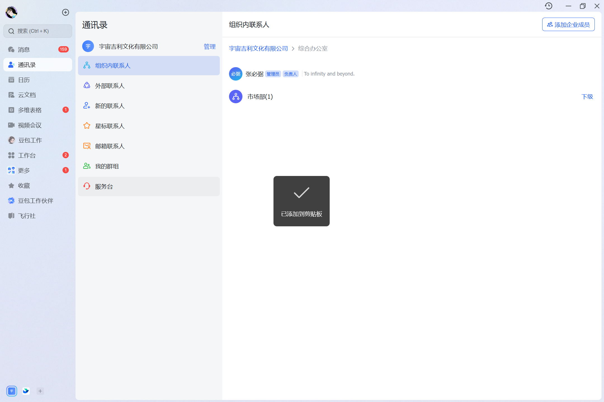
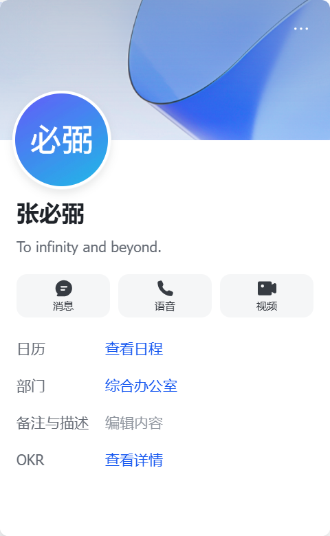
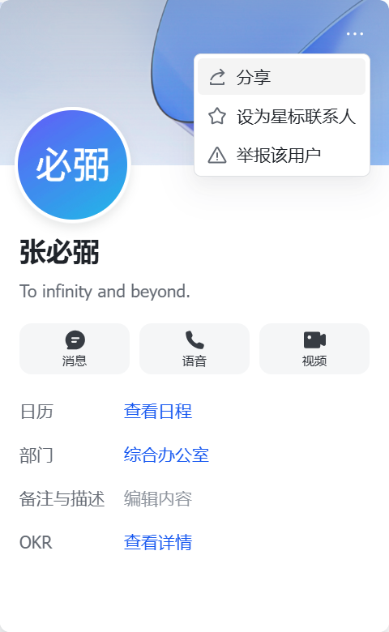

# PC Client 通讯录样式改造方案（飞书风格）

> 文档状态：原型改造方案（本轮只出方案，不改代码、不提交、不部署）
> 提出日期：2026-11-26
> 影响域：PC 客户端 `/pc_client/contacts`（`src/pages/Contacts.tsx` 及其子组件）
> 不在范围：PC Web 门户通讯录（`src/pages/PcWebPortal.tsx`）、管理后台、Vue App Harness（`src/prototype/`）
> 依据：三张参考截图（见 `docs/assets/`）、`docs/UI_DESIGN_GUIDELINES.md` v1.3、`docs/CLIENT_INTERACTION_SURFACES.md` v1.0、`Agents.md`

参考图（飞书客户端桌面通讯录、手机联系人名片、手机联系人右上角菜单）：

| 桌面端总览 | 联系人名片 | 右上角菜单 |
| --- | --- | --- |
|  |  |  |

---

## 1. 背景与目标

现有 PC Client 通讯录（2026-11-17 上线）是"组织树 + 成员列表 + 常驻详情"三栏结构，功能完整但视觉偏后台管理：树状缩进、表单式资料卡、三个实心操作按钮。

本次改造目标：**换成参考图（飞书风格）的轻量样式与信息层级，但功能、数据契约和行为口径完全沿用现有原型**——已有的组织浏览、备注、特别提醒、发消息、视频会议等能力一项不删（发起群聊、OKR、名片内搜索与添加企业成员按 2026-11-26 产品反馈移除，见 §12.2 / §12.3）；参考图里出现、但当前没有后端/模型支撑的能力（外部联系人、举报、分享、添加企业成员、真实通话等），只做视觉入口并诚实标注"暂未开放"，不伪造功能、不落假数据。

改造完成后应达到：

1. 通讯录页内部从"三栏"变为"**分类菜单 + 组织层级浏览区**"，联系人详情从常驻第三栏改为**居中弹框名片卡片**（参考飞书）。
2. 视觉上对齐参考图的信息层级（企业头、分类菜单、面包屑、部门行/人员行、标签、签名、名片式详情、更多操作菜单），但颜色一律走项目系统令牌，**不引入参考图的蓝色体系**。
3. 所有现有功能可在新样式中找到明确落点（映射关系见第 10 节），数据层仅做**可选字段**与**本地偏好项**的向后兼容扩展。
4. 交互载体选择符合 `docs/CLIENT_INTERACTION_SURFACES.md`：名片用**居中弹框卡片**（Modal，对齐飞书形态）、更多操作用轻量浮层，不新增路由。

---

## 2. 参考图拆解

### 2.1 桌面端（图一）

- **最左应用导航栏**：头像、搜索（Ctrl+K）、消息/通讯录/日历/云文档/多维表格/视频会议/工作台等，带未读红点。**这是应用外壳，项目已有全局导航（`Layout.tsx`），不在通讯录页内重建。**
- **第二栏（通讯录分类菜单）**：
  - 顶部标题"通讯录"。
  - 企业头：品牌色圆形方块（"宇"）+ 企业名称 + 右侧蓝色"管理"链接。
  - 分类项，每项有独立线性图标，选中项为浅色圆角 pill：
    组织内联系人（选中）/ 外部联系人 / 新的联系人 / 星标联系人 / 邮箱联系人 / 我的群组 / 服务台。
- **主内容区**：
  - 顶部：标题"组织内联系人"；右上角描边按钮"添加企业成员"（**2026-11-26 已移除**，见 §12.3）。
  - 面包屑：企业名（蓝色链接）> 当前部门（灰色）。
  - **人员行**：品牌色渐变圆形头像（白字"必弼"）+ 姓名 + 浅蓝标签"管理员""负责人" + 签名"| To infinity and beyond."。
  - **部门分组行**：紫色组织图标 + "市场部(1)" + 右侧蓝色"下级"链接。
  - 中央深色 Toast："✓ 已添加到剪贴板"。

### 2.2 联系人名片（图二，手机）

- 顶部蓝色抽象氛围 banner，右上角"..."。
- 大尺寸渐变圆形头像（与 banner 重叠）+ 姓名（大字加粗）+ 灰色签名。
- 三个浅灰圆角操作块：**消息 / 语音 / 视频**。
- 信息行（左灰色标签，右蓝色值）：日历 → 查看日程；部门 → 综合办公室；备注与描述 → 编辑内容（无内容时灰色）；OKR → 查看详情。

### 2.3 右上角菜单（图三，手机）

"..."锚点浮层：**分享 / 设为星标联系人（空心星标）/ 举报该用户（警告三角）**。

### 2.4 从参考图中只取"形"，不取"色"

按 `docs/UI_DESIGN_GUIDELINES.md` 与 `docs/APP_UI_GUIDELINES.md` 第 115 行的既定口径：IM/通讯录只参考结构与交互，蓝紫渐变、蓝色链接、浅蓝选中底等一律映射为项目品牌令牌（详见第 14 节）。

---

## 3. 现状盘点

### 3.1 现有文件

| 文件 | 职责 | 本轮处理 |
| --- | --- | --- |
| `src/pages/Contacts.tsx`（418 行） | 通讯录页：搜索、组织树、成员列表、详情第三栏、群聊弹层、Toast | **重构为页面编排 + 新增子组件** |
| `src/data/contactDirectory.ts` | `ContactPerson`、组织树 `CONTACT_ORG_ROOT`、人数统计、演示 fixture（三国人名 / 吉祥航空） | **仅增量加可选字段** |
| `src/store/contactDirectoryStore.ts` | zustand+persist：备注 `note`、特别提醒 `specialReminder`，key=`ijx-contact-preferences-v1` | **加 `starred`，带版本迁移** |
| `src/utils/contactMessaging.ts` | "发消息"桥接：写 localStorage 后跳 `/pc_client`，由 `Home.tsx` 消费建单聊 | 不动 |
| `src/components/ContactPicker.tsx` | 通用通讯录选人器（日程/会议子窗口、Admin、OKR 等都在用） | **不动，继续被群聊弹层复用** |
| `src/components/interaction/Modal.tsx` / `Drawer.tsx` / `Popover.tsx` | 统一交互载体组件 | 名片用 Modal（加可选 `header`）；另两个本轮未使用 |
| `src/pages/PcWebPortal.tsx`（113–156 行） | PC Web 门户通讯录（部门列表 + 双列名片卡） | **不动** |
| `src/prototype/views/message/Contacts.vue` | App/Vue 原型通讯录（含服务号、消息应用、星标 toggle 等） | 不动（仅作功能口径参考） |
| `src/App.tsx`、`src/components/Layout.tsx` | 路由与全局外壳（通讯录是主导航，不计入"打开的页面"） | 不动 |

### 3.2 现有功能清单（改造必须全部保留）

1. **搜索**（2026-11-26 已移除，见 §12.3）：原为姓名（完整命中优先）/ 手机号 / 账号 / 邮箱 / 部门 / 职位六字段；trim + 忽略大小写；命中字段标注；上限 100 人并提示；清空按钮；无结果空态。
2. **组织浏览**：公司根（吉祥航空）→ 7 个部门两级树；展开/收起；节点人数（含子部门）；成员按部门归集。
3. **Tab**：组织架构 / 我的群组（群组 Tab 当前为"暂未开放，群组数据可在消息页查看"空态）。
4. **成员列表**：头像 + 在线状态角标（mock：在线/忙碌/离开/离线）+ 姓名 + 职位 · 部门 + 部门人数。
5. **常驻详情第三栏**：状态文案、职位 · 部门 · 组织单元；账号、手机、座机、邮箱、部门、工号 6 个字段。
6. **备注**：行内输入，失焦保存，zustand persist，Toast"备注已保存"。
7. **特别提醒**：switch 开关，按联系人持久化。
8. **发消息**：`openChatWithContact` → 消息页创建/复用单聊并选中。
9. **发起群聊**：打开 `ContactPicker` 弹层（当前联系人锁定、至少再选 1 人校验），确认时诚实 Toast"群聊创建功能暂未开放"，不落会话、不造假群名。
10. **视频会议**：`navigate('/pc_client/meetings', { state: { startMeeting: {...} } })`，带入当前联系人为参会人。
11. **Toast**：底部居中深色胶囊；mock 数据有明确小字标注。

### 3.3 现有数据模型

```ts
ContactPerson {
  id, name, company, email,
  department, organizationUnit, title,
  officePhone, mobile, employeeNo,
  account?,            // 域账号（邮箱前缀派生）
  status?,             // online | busy | away | offline（固定 mock 派生）
}
ContactOrgNode { id, name, parentId?, memberIds?, children? }
// 偏好：{ note: string; specialReminder: boolean }，按联系人 id 持久化
```

`CONTACT_ORG_ROOT` 为"公司根 → 7 部门"两层；`PcWebPortal.tsx` 还导出使用 `contactGroups`、`contactDirectory`，因此数据扩展必须是纯增量、可选字段。

---

## 4. 改造原则与边界

1. **功能零删减**：第 3.2 节的 11 项能力全部保留，含"暂未开放"的诚实口径；只换承载位置与视觉。
2. **载体合规**：名片卡片 Modal、更多菜单轻量浮层；不新增一级路由，浮层不进 URL（符合交互载体规范 §3.1）。
3. **令牌合规**：只使用 `src/index.css` 语义变量与 Tailwind 类；蓝色参考元素映射品牌主色 `#B82971` / 辅助色 `#D49A73` / 中性色 N 系；深浅色双主题。
4. **数据向后兼容**：fixture 只加可选字段（`signature?`、`badges?`）；偏好 store 加 `starred` 并做 persist version 迁移，老用户备注不丢。
5. **不伪造能力**：企业管理、外部/新的/邮箱联系人、服务台、分享、举报、真实语音通话，统一为"入口可见 + 暂未开放 Toast/空态"（添加企业成员按 §12.3 已整项移除）。
6. **不影响他处**：`ContactPicker`、PC Web 通讯录、日程/会议子窗口、Admin 用户组、OKR 等消费方零改动。
7. **最小宽度 1024px**：遵循 UI 规范 §7，不做移动端响应式重排；名片为居中浮层，覆盖主区但不挤压列表布局。

---

## 5. 目标布局总览

页面仍在 `Layout` 的**单一白色主工作面**（`client-main-shell` 圆角白底）内部，以分割线分成两块；最外层全局导航保持不变：

```
┌ 全局导航 168px（Layout，不动）┬ 白色主工作面（圆角 16，现有外壳）──────────────────────┐
│                              │ ┌ 分类菜单 264px ┬ 浏览区 flex-1 ────────────────────┐ │
│  消息 159                    │ │ 通讯录          │ 组织内联系人                      │ │
│  通讯录（选中）              │ │ ────────────── │ 吉祥航空 〉市场部                 │ │
│  日历 …                      │ │ ▣ 企业头（宇 吉祥│ ──────────────────────────────── │ │
│                              │ │   航空)    管理 │ [部门行] 市场部(1)          下级  │ │
│                              │ │ ◉ 组织内联系人  │ [人员行] (渐变头像) 周瑜  负责人 │ │
│                              │ │ ○ 外部联系人    │   市场总监 | 签名……               │ │
│                              │ │ ○ 新的联系人    │                                   │ │
│                              │ │ ☆ 星标联系人    │                                   │ │
│                              │ │ ✉ 邮箱联系人    │                                   │ │
│                              │ │ ◇ 我的群组      │                                   │ │
│                              │ │ ◔ 服务台        │                                   │ │
│                              │ └────────────────┴───────────────────────────────────┘ │
│                              │      点击人员行 → ContactProfileCard（居中弹框 420）    │
└──────────────────────────────┴──────────────────────────────────────────────────────┘
```

与现状对照：**第一栏组织树 → 分类菜单**；**第二栏成员列表 → 与第三栏合并为浏览区**（部门行 + 人员行同层，面包屑表达层级）；**第三栏详情 → 居中弹框名片卡片**。页面整体仍为两个视觉块（全局导航 + 一个白色工作面，工作面内部分栏用分割线衔接），符合 UI 规范 §3.4。

---

## 6. 第二栏：分类菜单 `ContactCategoryNav`

位置：白色工作面内左侧，宽 `264px`（`min-w-[240px]`），右 `1px` 分割线，独立纵向滚动。

### 6.1 结构

1. **栏标题**："通讯录"，`16-18px / 600` 标题色，左对齐，`px-5 pt-5 pb-3`。
2. **企业头**：
   - 品牌色渐变圆对方块（`40px`，圆角 `12px`，白字"宇"，取公司名首字；渐变取 `--ui-brand-primary` → 辅助色 `#D49A73`，**克制使用，仅企业头与头像**）。
   - 公司名：`contactDirectory[0].company`（上海吉祥航空股份有限公司），单行省略，标题色 `14px/600`。
   - "管理"链接：品牌主色 `13px`；点击 Toast"企业管理暂未开放，请在管理后台操作"（不跳 Admin，避免原型内角色混淆；待产品确认，见 §16）。
3. **分类项列表**：高 `40px`、圆角 `10px`、左右 `12px` 内边距、图标 `17-18px`、文字 `14px`；选中态为品牌色 `8%` 底色 + 品牌色文字与图标；hover 为选中背景中性色 `--ui-surface-selected`。

| 分类项 | 图标（lucide） | 数据/行为 |
| --- | --- | --- |
| 组织内联系人 | `Building2` / `Network` | 默认选中；浏览区为组织层级视图（第 7 节） |
| 外部联系人 | `UserRoundPlus`（或 `ContactRound`） | 空态："暂无外部联系人"+"暂未开放"标 |
| 新的联系人 | `UserPlus` | 空态："暂无新的联系人通知" |
| 星标联系人 | `Star` | **真实可用**：列出 `preferences` 中 `starred=true` 的人；空态"暂无星标联系人" |
| 邮箱联系人 | `Mail` | 空态 + "暂未开放" |
| 我的群组 | `Users` | 沿用现有口径："我的群组浏览暂未开放（群组数据可在消息页查看）" |
| 服务台 | `Headset` / `LifeBuoy` | 空态 + "暂未开放" |

空态统一组件 `ContactEmptyScope`：居中线性图标（弱色）+ 一句话 + 可选"暂未开放"小胶囊；与 `prototype` 中 `ImEmpty` 口径一致但用系统令牌。

> 现状的"组织架构 / 我的群组"两个 Tab 被该菜单取代；分类切换不清空当前部门节点。

### 6.2 与参考图的差异说明

- 不做参考图最左应用导航（外壳已有）。
- 分类数量对齐参考图 7 项；其中 4 项为诚实空态，不删项，保留视觉完整度。
- 星标为唯一新增的**真实**本地能力，与手机菜单"设为星标联系人"呼应（§9）。

---

## 7. 主内容区：组织层级浏览区 `ContactBrowser`

### 7.1 顶部栏（固定，不随列表滚动）

- 标题行：栏目标题随分类变化（组织内联系人 / 星标联系人 / 外部联系人…）。
- 面包屑行（仅组织内联系人分类显示）：公司名（品牌色按钮，点击回公司根视图）`ChevronRight 12px` + 当前节点名（正文色）。根视图只显示公司名。
- 标题下 `1px` 分割线；浏览区本体独立滚动。

> **2026-11-26 产品调整：移除"添加企业成员"按钮与通讯录内搜索框。** 顶栏只保留标题与面包屑，通讯录内不再提供按人检索；需要按人查找时使用全局导航的全局搜索。原 `searchContacts`、`keyword` 状态、搜索结果态与"未找到相关联系人"空态一并删除（详见 §12.3）。

### 7.2 组织视图（分类=组织内联系人）

飞书模型：**当前节点视图 = 直属人员行 + 子部门分组行**，面包屑表达层级，点击部门行/"下级"进入下一层。

- **公司根视图**：渲染 7 个部门行（根 `memberIds` 为空）。
- **部门视图**：渲染该部门 `memberIds` 对应的人员行（当前数据无子部门，组件仍按"直属人员 + children 分组行"通用实现，天然支持以后挂三层组织）。
- **部门行**（`ContactDeptRow`）：
  - 左：`36-40px` 圆角 `10px` 浅紫/弱品牌底组织图标（映射参考图紫色图标 → 辅助色/品牌色弱底，不用紫）。
  - 文案：`部门名(直属人数)`；右：品牌色文字按钮"下级"（有 children 时显示）。
  - 整行可点击：有子部门 → 进入该节点（面包屑下钻）；无子部门的叶子部门，点击行同样进入该部门视图（显示其人员）。当前 fixture 两层，所以点击部门即看到成员。
  - 不再需要"展开/收起箭头"：下钻模型替代树展开模型；节点人数用 `countContactOrgMembers`（含子部门）。
- **人员行**（`ContactPersonRow`，高 `64-72px`，hover 中性底，无卡片边框，行间用极弱分割线或纯间距）：
  - `40-44px` 圆形渐变头像 + 白字（人名末两位/首字，与参考图"必弼"一致：中文名取**后两个字**，两字名取全名）；头像右下角保留在线状态小圆点（mock 四色）。
  - 姓名 `14px/600` 标题色；姓名后渲染 `badges` 标签。
  - **标签**：浅品牌色底（品牌色 10%）+ 品牌色文字、圆角 `4px`、`11px`，高 `20px`。fixture 仅给少数演示人配置（建议：刘备"负责人"、曹操"管理员"，共 2 枚，避免满屏标签）。
  - 签名：姓名行下方或同列，弱文字 `13px`；无签名不占位。
  - 行右侧不放操作按钮（参考图也没有）；整行点击打开名片卡片。

### 7.3 其他分类

- 星标联系人：人员行列表（数据来自 starred 偏好），点击开名片；在名片取消星标后列表即时刷新。
- 其余分类：`ContactEmptyScope` 空态。

### 7.4 状态与默认值

- 默认：分类=组织内联系人、节点=公司根、**不默认选中任何人、不打开名片**（与现状"默认选中第一人"不同，对齐参考图主区初始为列表的形态）。
- 保留浏览状态：分类切换、名片开关不重置当前部门节点。
- 在线状态 mock 小字标注保留，挪到浏览区列表底部（"在线状态为演示数据（mock）"，`10px` 弱色）。

---

## 8. 联系人名片：居中弹框卡片 `ContactProfileCard`

参考飞书 PC 端的联系人名片形态：**居中浮层卡片**（宽 `420px`、圆角 `16px`、遮罩 `bg-black/45`、Esc/点遮罩关闭），不是右侧抽屉。实现复用 `src/components/interaction/Modal.tsx`（自带焦点陷阱、Esc、遮罩关闭、关闭后焦点归还），通过新增的可选 `header` 以氛围头替换默认白底标题栏。

> 载体口径修正：名片属于"查看 + 轻量操作"的浮层卡片，按产品要求对齐飞书，采用 Modal 而非 Drawer；`docs/CLIENT_INTERACTION_SURFACES.md` 中"信息查看用 Drawer"的默认建议在本页让位于飞书形态，后续若回流为抽屉需重新评审。

### 8.1 结构（自上而下）

1. **氛围头**：高 `88-104px`，使用已入库的品牌氛围图素材 `src/assets/brand-ambiance.webp`（粉紫柔和渐变，对应设计参考图"组 204@2x"），通过统一工具类 `.ambiance-brand` + `.ambiance-brand-lead`（见 `src/index.css`，以 CSS 变量 `--ui-ambiance-brand` 引用）铺底；**不用参考图的高饱和蓝**。`-lead` 取氛围图左上角粉色区域，避免 `cover` 居中裁到图中最白的一段；叠加一层 `bg-white/25` 弱遮罩保证右上角控件可读；深色模式由 `.dark .ambiance-brand` 自动压暗。右上角为 `...` 更多按钮（`Ellipsis`，触发 §9 菜单）与关闭 `X`，两者为白底半透明 + 细白边 + `shadow-sm`，在浅粉底上保持可见。
2. **头像 + 身份区**：`72px` 渐变圆（与人员行同算法）+ `ring-4` 白边，重叠氛围头约 `36px`；右侧姓名（`20px/600`）+ 在线状态点与文案（弱色 `14px`），下方签名（`14px` 弱文字，无签名不占位）。
3. **三个操作块**：等宽三列、浅中性底 `bg-[var(--ui-surface-selected)]` 圆角 `12px`、高 `68px`，垂直图标 + 文字：
   - **消息**（`MessageSquare`）→ `openChatWithContact(selected.name, navigate)`，**行为完全不变**。
   - **语音**（`Phone`）→ Toast"语音通话暂未开放"（与 Vue 原型 `toast('语音通话暂未开放')` 同口径；真实媒体流未接入）。
   - **视频**（`Video`）→ 现有 `startMeeting(person)`：跳 `/pc_client/meetings` 并带 `state.startMeeting`。
   - 视觉为浅色块、非三枚大按钮；点击有 hover 反馈。
4. **信息行区**（白底，行高 `46px`，左 `86px` 固定宽弱色标签，右值 `14px`）：

   | 标签 | 值 / 控件 | 行为 |
   | --- | --- | --- |
   | 日历 | 查看日程 | 品牌色：`navigate('/pc_client/calendar')` |
   | 部门 | `department`（组织单元作副行） | 品牌色：关闭名片 → 浏览区跳到该人员所属部门节点（与组织视图联动） |
   | 职位 | `title` | 纯展示 |
   | 备注与描述 | 有值显示值；无值显示灰色"编辑内容" | 点击原地变为 input（现有行内编辑逻辑），失焦/Enter 保存 + Toast，store key 不变 |
   | 特别提醒 | switch（右置） | 现有 `toggleSpecialReminder`，仅这一行右值是开关不是链接 |
   | 更多资料 | "账号、手机、邮箱等 ⌄" | 点击展开/收起下方五行（`aria-expanded`，箭头旋转） |

   "日历"是参考图带来的**视觉新入口**，原型已有对应页面，仅做导航，不新增业务。
   **2026-11-26 产品调整：名片移除 OKR 行与"发起群聊"入口**（详见 §12.2）。
5. **更多资料（默认收起）**：账号、手机、座机、邮箱、工号五行，展开后接在信息行下方。
   - 默认收起以保证名片一屏显示全部核心信息、无内容被底部裁切；展开后内容超出 `max-h-[90vh]` 时由卡片内部滚动（Modal 自带）。
   - 沿用键值行式；值后带复制小图标（`Copy 13px`），点击 `navigator.clipboard.writeText`，成功 Toast"**已添加到剪贴板**"（沿用参考图文案；注意 catch 拒绝与无焦点环境，失败提示"复制失败，请手动选择文本"）。
   - **手机号默认隐藏、点击"查看"后才显示**（对齐 PC Web 门户 `PcWebPortal.tsx` 的 `toggleMobile` 交互口径）：未查看时该行只显示品牌色"查看"链接，不含号码与复制按钮；查看后显示号码 + 复制，关闭名片或切换联系人后恢复隐藏。
   - 手机号沿用 fixture 的脱敏样式（`138****4200`），查看后展示与复制的都是脱敏串；PC Web 门户的明文逻辑本轮不引入。
   - 名片无固定底部操作区：卡片到"更多资料"结束，不保留"发起群聊"按钮与底部说明行。

### 8.2 与现状详情的字段对照

| 现状第三栏 | 名片卡片落点 |
| --- | --- |
| 头像 + 状态点 + 在线文案 | 氛围头 + 大头像 + 姓名行状态点/文案 |
| 职位 · 部门 · 组织单元 | 部门信息行（值 + 副行组织单元）、职位行 |
| 账号/手机/座机/邮箱/部门/工号 6 行 | 信息行区（部门）+ 更多资料区（其余 5 项，手机需点击查看） |
| 备注行内编辑 | 备注与描述行（编辑内容 → input） |
| 特别提醒 switch | 信息行区 switch 行 |
| 发消息 / 发起群聊 / 视频会议 | 消息块 / **已移除** / 视频块（语音为新增的"暂未开放"入口） |

---

## 9. 右上角更多菜单 `ContactMoreMenu`

复用 `src/components/interaction/Popover.tsx` 的定位思路，锚定名片氛围头"..."按钮（实现采用项目既有的 `fixed` 遮罩 + 绝对定位菜单，避免 Popover 外部点击与触发按钮同层的手感问题），宽 `180-200px`，白底圆角 `12px`、阴影、`8px` 内边距，项高 `38px`、图标 `16px`，点击外部/Esc 关闭：

| 菜单项 | 图标 | 行为 |
| --- | --- | --- |
| 分享 | `Share` / `Forward` | Toast"分享暂未开放"（不调用 navigator.share，避免容器内行为不一致；待产品确认） |
| 设为星标联系人 / 取消星标 | `Star`（已星标时 fill 琥珀色或品牌色） | 调 `toggleStarred(contactId)`，Toast"已设为星标联系人"/"已取消星标"；菜单文案随状态切换 |
| 举报该用户 | `TriangleAlert` | Toast"举报暂未开放"（不做假表单、不落数据） |

星标与"特别提醒"是两件事：**星标**=联系人收藏（对应参考图与"星标联系人"分类，纯本地展示）；**特别提醒**=现有消息强提醒开关，语义不动，继续放在名片信息行。

---

## 10. 功能映射总表（验收基线）

| # | 现有功能（2026-11-17 版） | 改造后位置 | 行为变化 |
| --- | --- | --- | --- |
| 1 | 全局导航"通讯录"入口与未读体系 | `Layout.tsx` 不动 | 无 |
| 2 | 六字段搜索 + 优先级 + 百人上限 + 命中字段 + 清空/空态 | **已移除**（浏览区不再提供搜索框，`searchContacts`/`hitField`/结果态一并删除） | 2026-11-26 产品调整，见 §12.3 |
| 3 | 组织树浏览（展开/收起、人数、部门归集成员） | 分类菜单"组织内联系人" + 面包屑下钻的部门行/人员行 | 展开模型→下钻模型；数据结构与统计算子不动 |
| 4 | "我的群组"Tab 空态 | 分类菜单"我的群组" | 文案口径不变 |
| 5 | 成员列表（头像/状态点/姓名/职位·部门/人数） | 浏览区人员行 + 部门行 | 视觉升级（渐变头像/标签/签名），状态点保留 |
| 6 | 默认选中第一人、第三栏常驻详情 | 默认无选中；点击人员行开名片卡片 | 交互模型变化（产品期望） |
| 7 | 详情 6 字段资料 | 名片信息行 + 可展开的更多资料 | 无缺失；手机改为点击查看，账号/座机/邮箱/工号可复制 |
| 8 | 备注行内编辑 + persist + Toast | 名片备注行 | store/key/时机不变 |
| 9 | 特别提醒 switch + persist | 名片信息行 | 无 |
| 10 | 发消息桥接（localStorage → Home 建单聊） | 名片"消息"块 | `openChatWithContact` 不动 |
| 11 | 发起群聊（ContactPicker 锁定/校验/暂未开放） | **已移除**（名片不再提供群聊入口，页面不再挂载 ContactPicker 弹层） | 2026-11-26 产品调整 |
| 12 | 视频会议带参跳转 | 名片"视频"块 | 无 |
| 13 | Toast 体系 | 复用；新增复制/星标/各类"暂未开放"文案 | 样式沿用，位置可微调为参考图居中样式 |
| 14 | mock 标注（在线状态） | 浏览区底部小字 | 无 |
| — | **新增视觉入口（无新后端）** | 企业头"管理"、外部/新的/邮箱联系人、服务台、语音、分享、举报 | 全部"暂未开放"诚实口径 |
| — | **新增真实本地能力** | 星标联系人（分类 + Popover + store） | 新增，persist 可迁移 |
| — | **新增导航入口** | 名片"日历"、部门行联动 | 仅路由跳转现有页 |

---

## 11. 数据模型与状态扩展

### 11.1 `src/data/contactDirectory.ts`（纯增量）

```ts
export interface ContactPerson {
  // ……现有字段全部保留……
  /** 名片签名（演示数据；参考图 "To infinity and beyond."） */
  signature?: string;
  /** 人员标签（演示）：如 '管理员' | '负责人'，渲染为姓名后小标签 */
  badges?: string[];
}
```

- 在 `directoryDefinition` 生成对象时追加：`signature`（给全部人给统一弱签名或部分人留空以验证空态）、`badges`（仅刘备 `['负责人']`、曹操 `['管理员']` 两枚演示）。
- 组织树 `CONTACT_ORG_ROOT`、`countContactOrgMembers`、`flattenContactOrg`、`contactGroups`、`findContactByName` 签名不动；PC Web 与 ContactPicker 零影响。
- 渐变头像：新增本地工具函数（建议放 `src/data/people.ts` 或 contacts 组件内），**不依赖 dicebear 远程服务**的新生成路径——姓名末两位白字 + 品牌色渐变底（纯 CSS/SVG data URI），与参考图一致且离线可用；现有 `getInitialsAvatar` 保留供其他页面。

### 11.2 `src/store/contactDirectoryStore.ts`

```ts
export type ContactPreference = {
  note: string;
  specialReminder: boolean;
  starred: boolean;          // 新增
};
```

- 增加 `toggleStarred(contactId)`；`getPreference` 默认值补 `starred:false`。
- persist 保持 `name: 'ijx-contact-preferences-v1'`，加 `version: 2` 与 `migrate`：老数据逐人补 `starred:false`，保证备注不丢（key 不改，避免双版本并存）。

### 11.3 不引入的东西

- 不建外部联系人/服务台/企业管理的数据模型与接口。
- 不引入在线状态服务（继续固定派生 mock）。
- 不引入星标与消息模块的联动（App 原型里 `toggleContactStar` 是 IM store 的另一套，PC 端不打通）。

---

## 12. 文件改造清单

| 动作 | 文件 | 说明 |
| --- | --- | --- |
| 重构 | `src/pages/Contacts.tsx` | 收敛为状态编排（分类/节点/名片/Toast），删除 `OrgTree` 与第三栏 JSX；`startMeeting` 保留 |
| 新增 | `src/components/contacts/ContactCategoryNav.tsx` | 栏标题 + 企业头 + 7 个分类项 |
| 新增 | `src/components/contacts/ContactBrowser.tsx` | 顶栏（标题 + 面包屑）+ 部门行/人员行/空态编排 |
| 新增 | `src/components/contacts/ContactPersonRow.tsx` | 渐变头像、状态点、姓名、badges、签名 |
| 新增 | `src/components/contacts/ContactDeptRow.tsx` | 组织图标、部门名(n)、"下级" |
| 新增 | `src/components/contacts/ContactEmptyScope.tsx` | 分类空态/无结果空态 |
| 新增 | `src/components/contacts/ContactProfileCard.tsx` | 名片弹框卡片（含备注行内编辑、手机点击查看、复制、可展开更多资料） |
| 新增 | `src/components/contacts/ContactAvatar.tsx` | 统一渐变头像（人员行与名片共用） |
| 新增 | `src/components/contacts/ContactMoreMenu.tsx` | 遮罩 + 绝对定位菜单：分享/星标/举报 |
| 新增 | `src/constants/contactScopes.ts` / `contactStatus.ts` | 分类定义与在线状态常量 |
| 修改 | `src/data/contactDirectory.ts` | `signature?`、`badges?` 与 fixture 填充 |
| 修改 | `src/store/contactDirectoryStore.ts` | `starred` + `toggleStarred` + persist v2 migrate |
| 新增素材 | `src/assets/brand-ambiance.webp` | **已入库**（2026-11-26）：品牌粉紫氛围图，供名片头与后续弹窗/背景复用 |
| 修改 | `src/index.css` | **已完成**：`--ui-ambiance-brand` 变量 + `.ambiance-brand` / `.ambiance-brand-lead`（含深色压暗） |
| 小幅扩展 | `src/components/interaction/Modal.tsx` | 增加可选 `header`（默认标题栏行为不变），名片以氛围头替换默认标题栏 |
| 复用（不改） | `utils/contactMessaging.ts`、`interaction/Drawer.tsx`、`interaction/Popover.tsx` | — |
| 不改 | `App.tsx`、`Layout.tsx`、`PcWebPortal.tsx`、`ContactPicker.tsx`、`src/prototype/**` | 路由、外壳、PC Web、App 原型、通用选人器零改动 |

组件目录 `src/components/contacts/` 为本轮新建；命名沿用项目 PascalCase。

### 12.1 实施结果（2026-11-26，P0 + P1 已完成）

已按本方案 P0 + P1 落地，实际改动与上表一致，另有三个新增文件与四处实现偏差：

**新增文件**

- `src/components/contacts/ContactAvatar.tsx`：统一头像（品牌渐变 + 姓名后两字 + 在线状态点），人员行与名片共用。
- `src/constants/contactScopes.ts`：`ContactScope` 与 7 个分类定义（页面与左栏共用，避免重复常量）。
- `src/constants/contactStatus.ts`：在线状态色点与文案（演示数据集中管理）。

**相对方案的偏差（均为实现层最优解，不改变产品口径）**

1. **名片载体由 Drawer 改为居中弹框卡片**（产品要求对齐飞书）：复用 `Modal`，宽 `420px`、圆角 `16px`、遮罩 `bg-black/45`、焦点陷阱与 Esc 由 Modal 提供。`Drawer.tsx` 已回滚为原状，本轮零改动。
2. **更多菜单**未复用 `interaction/Popover.tsx`，改用项目既有的「`fixed` 透明遮罩 + 绝对定位菜单」（`Layout.tsx` 添加链接弹框同款）。原因：Popover 用 `document.pointerdown` 判定外部点击，与同层的触发按钮会产生"先关闭再打开"的手感问题；遮罩模式行为确定、关闭路径单一。
3. **企业头显示公司全称**（`contactDirectory[0].company`），企业方块标识字取组织根名称首字（吉祥航空 → 吉）；面包屑用组织根名 `吉祥航空`，比全称更适合窄栏且与组织树数据一致。
4. **更多资料默认收起**为"账号、手机、邮箱等 ⌄"行：11 行资料全展开会超出 `max-h-[90vh]`，导致底部内容被裁；收起后核心信息一屏完整，展开时由卡片内部滚动。

**验证（真实浏览器回归，Node + Chrome CDP，1440×900 与 1024×720 两档）**

40 项断言全部通过：页面渲染、分类菜单 7 项与文案、企业头、根视图 7 个部门行与人数、部门下钻与面包屑、名片弹框（**居中定位 / 宽 420 / 圆角 16** / 三操作块 / 信息行 / 更多资料默认收起与展开 / 群聊口径）、氛围头图片加载、更多菜单三项、星标（设置 → 分类联动 → 刷新后持久化）、Esc 关闭、搜索摘要与命中、服务台空态、1024 无横向溢出、零 console error 与零 runtime exception。

**氛围图使用约定（后续弹窗/背景可直接引用）**
```tsx
// 窄条头部：取左上角粉色区域，避免 cover 居中裁到图中最白段
<div className="ambiance-brand ambiance-brand-lead relative h-[104px]">
  <div className="absolute inset-0 bg-white/25" />  {/* 弱遮罩保证控件可读 */}
</div>

// 大面积背景：默认居中铺满
<div className="ambiance-brand relative" />
```

- 变量：`--ui-ambiance-brand`；工具类：`.ambiance-brand` / `.ambiance-brand-lead`；深色由 `.dark .ambiance-brand` 自动压暗。
- 不要在组件内重复写图片路径或复制图片文件；窄条一律加 `-lead` 与弱遮罩。

### 12.2 名片字段调整（2026-11-26 产品反馈）

按产品验收意见调整名片字段，已实施并回归：

| 调整项 | 变更前 | 变更后 |
| --- | --- | --- |
| 发起群聊 | 名片底部"发起群聊"按钮 + 群聊选人 Modal（诚实"暂未开放"） | **整项移除**：按钮、底部说明行、`onRequestGroupChat` prop、页面群聊选人弹层与 `ContactPicker` 挂载、`groupMembers/createGroupChat` 状态一并删除（无入口即无死代码；`ContactPicker` 组件本身仍在其他模块使用，未改动） |
| OKR | 信息行"OKR → 查看详情"跳 `/pc_client/okr` | **整行移除**；`/pc_client/okr` 页面与其他入口不受影响 |
| 手机号 | 更多资料里直接显示 `138****4200` + 复制 | **默认只显示品牌色"查看"链接**，点击后才显示号码与复制按钮（对齐 PC Web 门户 `toggleMobile` 口径）；关闭名片或切换联系人后恢复隐藏 |

调整后的名片：`氛围头 + 头像 + 姓名/在线/签名 → 消息/语音/视频 → 日历/部门/职位/备注/特别提醒/更多资料`，卡片到"更多资料"结束，无固定底部操作区。

回归结果：42 项断言全部通过（含"已移除发起群聊与群聊口径""信息行齐全（无 OKR）""手机号默认隐藏为「查看」""点击查看后显示手机号并可复制"）。

### 12.3 浏览区顶栏精简（2026-11-26 产品反馈）

按产品验收意见去掉浏览区顶栏的两个入口，已实施并回归：

| 调整项 | 变更前 | 变更后 |
| --- | --- | --- |
| 添加企业成员 | 标题行右侧描边按钮，点击 Toast"添加企业成员暂未开放" | **整项移除**：按钮与 `onAddMember` prop、对应 Toast 文案删除 |
| 通讯录搜索 | 面包屑行右侧搜索框（六字段、命中标注、百人上限、清空/无结果空态） | **整项移除**：搜索框、`keyword` 状态、`searchContacts`/`SearchHit`、搜索结果态与"未找到相关联系人"空态、`hitField` 命中标注、`ContactEmptyScope` 的 action 支持一并删除；按人查找改由全局导航的全局搜索承担 |

顶栏结构因此简化为「标题 + 面包屑（仅组织内联系人分类）」两行，`ContactBrowser` 的 props 收敛为 `title / breadcrumb? / onNavigateCrumb / footerNote? / children`。

回归结果：43 项断言全部通过（含"已移除添加企业成员按钮""已移除通讯录搜索框""组织内分类无搜索框/无添加按钮""10 24 分类与部门可见"）。

---

## 13. 分阶段实施计划

### P0：主结构换肤（一个可验收版本）

1. 数据/状态扩展：`signature?`、`badges?`、`starred` 与迁移；渐变头像工具。
2. `ContactCategoryNav` + `ContactBrowser`（部门行/人员行/面包屑下钻）替换树+成员两栏（搜索后续按 §12.3 移除）。
3. `ContactProfileCard` 承接全部详情字段与消息/视频/备注/特别提醒；删除常驻第三栏。
4. 分类空态（外部/新的/邮箱/群组/服务台）与"管理"诚实入口（添加企业成员与搜索按 §12.3 后续移除）。
5. 验证：`npm.cmd run check`（types/build/routes/pages/app-chain/login）+ `npm.cmd run lint`；1024/1280/1440 三宽度目检；深色模式目检；零 console error。

### P1：补齐参考图细节

1. `ContactMoreMenu`（分享/星标/举报）与"星标联系人"真实分类联动。
2. 名片内日历跳转、部门联动定位、手机点击查看、账号/座机/邮箱/工号复制与"已添加到剪贴板"Toast。
3. Toast 居中样式微调、hover/pressed、键盘可达（人员行 focus-visible、名片焦点陷阱由 Modal 保证）。

### P2：回归与沉淀

1. 参照 `tools/prototype/verify-participant-selector.mjs` 风格，新增通讯录 smoke（可选）：断言分类项数量、根视图 7 部门、下钻面包屑、名片卡片打开/字段齐全、星标持久化、无搜索框与无添加企业成员入口。
2. 同步 `docs/HARNESS_MAP.md` / `Agents.md` 中的通讯录文件描述。
3. PC Web 门户通讯录是否同步换风格，单独立项（本轮不做）。

> P0/P1 可在同一轮实现完成后一次验收；拆分仅为降低 review 粒度。

---

## 14. 视觉令牌映射表

| 参考图元素（飞书蓝） | 项目落点 |
| --- | --- |
| 蓝色链接/可点文字（管理、下级、面包屑、查看日程） | `var(--ui-brand-primary)` `#B82971` |
| 浅蓝选中 pill（#E8F3FF 类） | `color-mix(in srgb, var(--ui-brand-primary) 8%, transparent)` 底 + 品牌色文字 |
| 蓝色描边按钮（参考图添加企业成员） | 参考图元素，本项目已移除该按钮；同类描边按钮用白底 + 品牌色 `1px` 描边 + 品牌色文字 |
| 蓝紫渐变头像/企业方块 | 品牌色 `#B82971` → 辅助色 `#D49A73` 的克制线性渐变，白字；全页仅此处渐变 |
| 浅蓝标签（管理员/负责人） | 品牌色 10% 底 + 品牌色文字，`rounded-4px`，`11px` |
| 紫色部门组织图标 | 辅助色/品牌色 10% 底 + 品牌色或 `#A86858` 图标 |
| 蓝色高饱和 banner | 品牌粉紫氛围图素材 `brand-ambiance.webp`（`.ambiance-brand`，深色下压暗）+ 弱遮罩，见 §8.1 |
| 三枚浅灰操作块 | `--ui-surface-selected`（#EBEDF0/#39393A）圆角 12 |
| 分割线/标题/正文/弱文字 | `--ui-border`、`--ui-text-title/body/weak` |
| 页面/工作面 | 外壳 `--ui-surface-page` + 白色工作面（沿用 Layout 现状） |
| Toast 深色胶囊 | 现有 `bg-gray-900/90` 深色胶囊（与参考图一致） |

深色模式：所有颜色走变量/`dark:` 类；渐变头像在深色下保持品牌渐变（白字可读）。

---

## 15. 验收标准

**功能不缺失**

- [ ] 第 10 节映射表 1–14 项原能力逐项可操作、文案口径与现状一致（含两处"暂未开放"）。
- [ ] 通讯录内无搜索框、无"添加企业成员"按钮；标题与面包屑正常，部门行可下钻。
- [ ] 备注在名片编辑后刷新/重开仍在（persist 迁移后老备注不丢）；特别提醒开关持久化。
- [ ] 发消息仍能桥接到消息页并选中/建单聊；视频仍带参会人跳会议页；手机号默认隐藏、点击"查看"后显示。
- [ ] 星标新增后：Popover 菜单变"取消星标"、"星标联系人"分类出现该人、刷新后保留。

**样式与交互**

- [ ] 全局导航不变；工作面内"分类菜单 264 + 浏览区"两块结构，分割线衔接，无卡片套卡片。
- [ ] 根视图 7 个部门行；点部门/下级下钻，面包屑可回根；人员行头像/标签/签名/状态点符合 §7.2。
- [ ] 名片为居中弹框卡片（宽 420、圆角 16），含氛围头、大头像、三操作块、信息行（日历/部门/职位/备注/特别提醒）、可展开更多资料；无 OKR、无发起群聊；Esc/遮罩/X 可关；主区可见且不挤压。
- [ ] 无任何蓝色硬编码（grep 新组件不得出现 `#3370ff`/`blue-`/`bg-blue` 等），无新增 UI 依赖。
- [ ] 1024 / 1280 / 1440 宽度无横向滚动、无遮挡；深色模式正常；hover/focus 可见。
- [ ] 无新增路由（`check:routes` 通过），通讯录不计入"打开的页面"。

**工程**

- [ ] `npm.cmd run check`、`npm.cmd run lint` 全绿；PC Web 通讯录、日程/会议参与者选人、Admin 用户组回归无影响。
- [ ] ContactPicker、contactMessaging、contactDirectory 对外导出签名不变。

---

## 16. 风险与待确认

1. **"管理"归属**：原型点击只给"暂未开放"Toast；若产品希望跳管理后台（`/admin` 用户管理），需确认跨角色入口策略后再定。
2. **语音入口口径**：名片"语音"目前必然是"暂未开放"；确认是否在 P0 就展示（参考图有，建议展示以保持视觉一致）。
3. **签名与标签为演示字段**：`signature`/`badges` 目前只在 contacts fixture；真实数据来源（HR/IM profile）待后端模型确认，字段命名先按可选演进。
4. **组织层级**：fixture 仅两层，下钻视图按 N 层实现但无法在原型数据下验证三层；如需可临时给市场部挂一个子部门做演示（默认不加假数据）。
5. **复制权限**：clipboard 在非安全上下文/无焦点可能失败，需 catch 并给"复制失败"反馈，不能静默。
6. **名片卡片与窄屏**：1024 宽时 420 卡片居中覆盖，主区两侧仍可见；再窄由现有最小宽度横向滚动策略兜底，不做移动端布局。
7. **Toast 位置**：参考图 Toast 在主区中央，现状为窗口底部居中；P1 微调时确认统一样式（建议沿用底部居中，避免遮挡列表操作）。
8. **头像方案**：渐变 + 名字末两位为纯前端生成，替代当前 dicebear 远程 initials（通讯录页内）；是否全局替换远程头像不在本轮。
9. **氛围图素材**：`brand-ambiance.webp`（2508×1672，约 407KB）为 webp，构建链（Vite/现网静态托管）需确认 Accept 正常；弹窗内使用时建议只在头部窄条铺图，避免多个弹窗重复解码；若后续要做整窗/登录页大背景，评估增加压缩小尺寸版本（如 1600 宽）。
